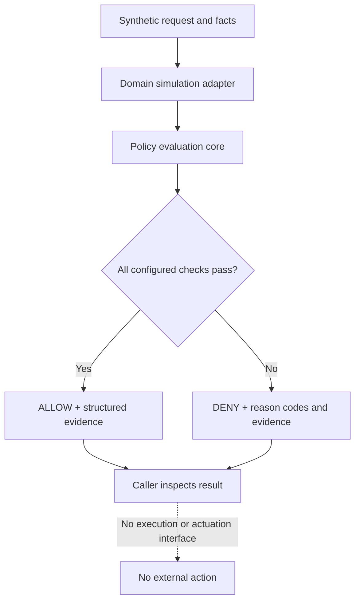

# Sentinel Interlock

**A local-first policy-evaluation reference for safety-focused simulations.**

An experimental, local-first reference implementation for evaluating whether an operational command should be permitted under explicit policy, authorization, state, freshness, and evidence constraints.

The portfolio MVP combines a generic policy-evaluation core with domain-specific simulation adapters. Examples cover a railway-inspired scenario and generic IT operations, using synthetic inputs only.

> **Safety boundary:** This is a research and portfolio MVP, not a railway interlocking, train protection system, industrial safety controller, or certified safety component. Never connect it to operational signalling, braking, dispatch, PLCs, production systems, or other safety-critical infrastructure. A demo decision is not a real-world safety guarantee.

## Goals

- Explainable, deterministic allow-or-deny decisions.
- Fail closed when required data is missing, stale, inconsistent, or unauthorized.
- Keep generic policy logic separate from domain-specific constraints.
- Provide structured decision evidence.
- Test failure modes and invariants, not only happy paths.
- Remain local-first and easy to run.

## Non-goals

- Replacing certified safety systems or human operational procedures.
- Calculating real braking curves, railway separation distances, route locking, or track occupancy.
- Claiming compliance or certification.
- Connecting to live telemetry or operational control paths.

## Architecture



The generic core checks actor and command allow-lists, required facts, context freshness, and explicit equality conditions. The actor identifier is not authenticated identity, and input facts are not trusted sensor data. The core produces a decision and evidence only; it does not execute the requested command.

The generic core must not define railway distances, braking limits, occupancy interpretations, or industrial thresholds. Domain constraints belong in explicitly scoped simulation adapters.

## Quick start

Requirements: Git and Python 3.12. Run these commands from a terminal in the repository root.

Clone the repository:

```shell
git clone https://github.com/silvatechf/interlock-safety-operations.git
cd interlock-safety-operations
```

Create an environment, install development dependencies, and run the demo and checks.

**Windows PowerShell:**

```powershell
py -3.12 -m venv .venv
.\.venv\Scripts\Activate.ps1
python -m pip install -e ".[dev]"
python examples/demo.py
pytest
ruff check .
mypy src
```

**macOS / Linux (Bash or compatible shell):**

```bash
python3.12 -m venv .venv
source .venv/bin/activate
python -m pip install -e ".[dev]"
python examples/demo.py
pytest
ruff check .
mypy src
```

## Demo output

Run `python examples/demo.py` to see three small, synthetic policy evaluations:

| Scenario | Expected decision | What it demonstrates |
| --- | --- | --- |
| Railway-inspired movement request; all example preconditions are true | `ALLOW` | A request can pass when the configured actor, context freshness, and required facts satisfy the example policy. |
| Railway-inspired request; section reported occupied | `DENY` | A failed precondition prevents the request from being allowed. |
| IT service restart; context is 31 seconds old | `DENY` | Stale context is rejected when the example policy allows at most 30 seconds. |

For each scenario, the script prints stable reason codes and versioned evidence JSON. Decision IDs and timestamps vary between runs. The facts are caller-supplied synthetic assertions, not trusted sensor or identity-provider data; no command is executed and no external system is contacted. The `ALLOW` result illustrates policy evaluation only—it is not a real-world safety determination.

## Engineering practices demonstrated

- **Typed Python design:** validated models in [`models.py`](src/sentinel_interlock/models.py).
- **Defensive policy evaluation:** allow-lists, freshness checks, required facts, and explainable deny reasons in [`engine.py`](src/sentinel_interlock/engine.py).
- **Automated verification:** [Hypothesis property tests](tests/test_properties.py), [evidence serialization tests](tests/test_serialization.py), and [session/replay tests](tests/test_session.py).
- **Code-quality gates:** Ruff linting and strict mypy checking, configured in [`pyproject.toml`](pyproject.toml).
- **Security hygiene:** Bandit static analysis, pip-audit dependency checks, GitGuardian secret scanning, and GitHub Actions pinned to full commit SHAs in [the CI workflow](.github/workflows/ci.yml).
- **Risk traceability:** [risk-to-test matrix](docs/risk-traceability.md) linking selected risks, mitigations, named tests, architecture, and residual limitations.

These links let reviewers inspect the implementation behind each claim. They describe practices present in this repository, not a claim that all risks are eliminated or that the system is independently verified.

## Status

Portfolio-stage reference implementation. Tests demonstrate only the software properties they cover, not operational safety or suitability.

## Docs

- [Architecture](docs/architecture.md)
- [Threat model](docs/threat-model.md)
- [Safety boundary and hazards](docs/safety-boundary.md)
- [Simulation scenarios](docs/simulations.md)
- [Risk-to-test traceability](docs/risk-traceability.md)
- [CI security maintenance](docs/ci-security-maintenance.md)
- [Portfolio scope review](docs/portfolio-scope-review.md)
- [Roadmap](docs/roadmap.md)
- [Documentación en español](docs/es/README.md)

## License

MIT — see [LICENSE](LICENSE).
