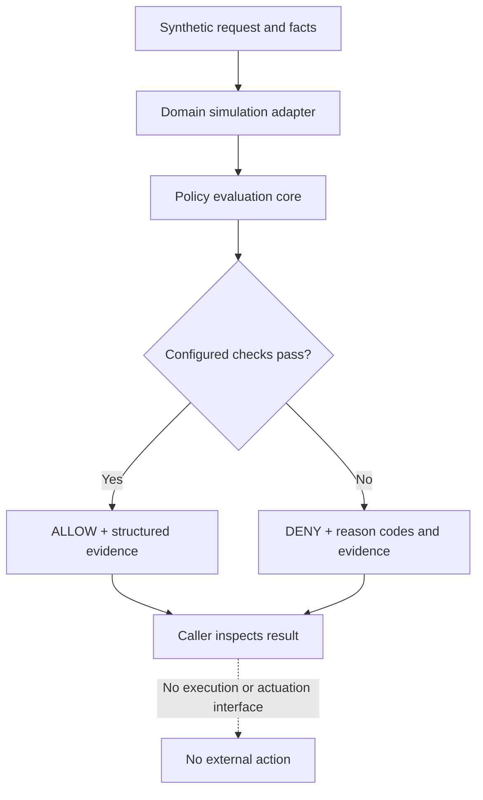

# Kernveil

**A local-first operational event validation and resilience research prototype.**

Kernveil is an experimental Python reference platform for evaluating the trustworthiness of synthetic operational events, detecting selected inconsistencies and communication failures, and producing explainable evidence. Its core is domain-agnostic; transportation is the first application family, with road-disruption simulation as the first new demonstrator. Railway, aviation, and maritime adapters are potential follow-on domains.

The current portfolio MVP combines a generic policy-evaluation core, a deterministic synthetic event validator, and an offline road-disruption scenario simulator. All scenarios use synthetic fixtures and produce review classifications only.

> **Safety boundary:** This is a research and portfolio prototype, not a navigation service, traffic-management platform, railway interlocking, train protection system, aviation or maritime control system, industrial safety controller, or certified safety component. Never connect it to live infrastructure, vehicles, signalling, braking, dispatch, traffic-light controllers, PLC/SCADA, or production systems. It does not issue right-of-way or movement instructions. A demo decision is not a real-world safety guarantee. No technology can promise zero risk or eliminate every failure.

## Product principles

- Treat source, freshness, integrity, sequence, and context as explicit validation questions.
- Distinguish invalid, stale, duplicated, contradictory, unknown, and indeterminate information.
- Fail closed where configured policy requires trustworthy evidence.
- Explain outcomes with stable reason codes and structured evidence.
- Keep the generic core separate from domain-specific semantics and assumptions.
- Simulate failures reproducibly; do not execute commands or actuate external systems.

## Domain strategy

The core is reusable; domain adapters are not interchangeable. The first new demonstrator is road disruption: synthetic traffic-light outages, collision and hazard reports, road closures, stale or duplicated crowd reports, and conflicting information. Railway scenarios remain part of the existing project. Maritime and aviation scenarios may follow only with separate threat models, explicit assumptions, and qualified domain review.

Kernveil is not another Waze or Google Maps. It does not provide live navigation or replace official alerts. It explores an independent validation layer that can assess whether synthetic event information is sufficiently current, consistent, and trustworthy for an advisory workflow.

## Current architecture



The implemented generic core checks actor and command allow-list assertions, required facts, context freshness, and explicit equality conditions. Actor identifiers are not authenticated identities, and input facts are not trusted sensor data. The core produces a decision and evidence only; it does not execute the requested command.

## Quick start

Requirements: Git and Python 3.12.

```shell
git clone https://github.com/silvatechf/interlock-safety-operations.git
cd interlock-safety-operations
```

**Windows PowerShell:**

```powershell
py -3.12 -m venv .venv
.\.venv\Scripts\Activate.ps1
python -m pip install -e ".[dev]"
python examples/demo.py
pytest
ruff check .
mypy src
```

**macOS / Linux:**

```bash
python3.12 -m venv .venv
source .venv/bin/activate
python -m pip install -e ".[dev]"
python examples/demo.py
pytest
ruff check .
mypy src
```

## Existing demo

The current demo covers three synthetic policy evaluations: a railway-inspired request that satisfies configured preconditions, a railway-inspired request denied because a section is reported occupied, and an IT restart request denied because its context is stale.

The facts are caller-supplied synthetic assertions, not trusted sensor or identity-provider data. No command is executed and no external system is contacted. ALLOW illustrates policy evaluation only, not a real-world safety determination.

## Engineering practices demonstrated

- **Typed Python design:** validated models in [models.py](src/sentinel_interlock/models.py).
- **Defensive policy evaluation:** allow-lists, freshness checks, required facts, and explainable deny reasons in [engine.py](src/sentinel_interlock/engine.py).
- **Automated verification:** [Hypothesis property tests](tests/test_properties.py), [evidence serialization tests](tests/test_serialization.py), and [session/replay tests](tests/test_session.py).
- **Code-quality gates:** Ruff linting and strict mypy checking in [pyproject.toml](pyproject.toml).
- **Security hygiene:** Bandit, pip-audit, GitGuardian, and GitHub Actions pinned to full commit SHAs in [CI](.github/workflows/ci.yml).
- **Risk traceability:** [risk-to-test matrix](docs/risk-traceability.md) linking selected risks, mitigations, tests, architecture, and residual limitations.

These practices describe what is present in the repository; they do not mean all risks are eliminated or that the system is independently verified.

## Event validation foundation

The initial `sentinel_interlock.events` module now validates a versioned synthetic event envelope, declared source allow-lists, freshness and expiry, duplicate IDs, sequence progression, and canonical payload digest consistency. It returns explicit VALID, REJECTED, or INDETERMINATE outcomes with reason codes. Replay state and source trust are caller-supplied assertions; they are not durable or cryptographically authenticated. Correlation, fault injection, and domain adapters remain planned.

## Kernveil Resilience Lab — planned

The initial road-disruption simulator is implemented in `sentinel_interlock.road_simulator` and can be run with `python examples/road_resilience_demo.py`. It runs six deterministic scenarios: healthy report, traffic-signal outage, stale report, duplicate delivery, unknown source, and contradictory reports. It classifies the information for review and never issues right-of-way, route, or driver instructions. Controlled fault injection, richer correlation, and evidence reports remain planned.

See the [Resilience Lab design](docs/resilience-lab.md) and [roadmap](docs/roadmap.md). Fault injection, richer correlation, and evidence reporting remain planned.

## Enterprise access decision prototype

The initial `sentinel_interlock.security` module evaluates synthetic identity, device-posture, session-scope, and privileged-approval assertions. It returns ALLOW, DENY, or INDETERMINATE with stable reason codes. The motivating scenario is a compromised workforce endpoint attempting to access a privileged resource.

This module is a Policy Decision Point (PDP), not a Policy Enforcement Point (PEP). It does not authenticate identities, inspect endpoints, revoke real sessions, issue credentials, or block API operations. All signals are caller-supplied assertions; source names and authentication-method labels are not cryptographic proof. See [enterprise security scope](docs/enterprise-security.md).

## Status

Portfolio-stage reference implementation. Tests demonstrate only the software properties they cover, not operational safety or suitability.

## Documentation

- [Architecture](docs/architecture.md)
- [Threat model](docs/threat-model.md)
- [Safety boundary and hazards](docs/safety-boundary.md)
- [Simulation scenarios](docs/simulations.md)
- [Risk-to-test traceability](docs/risk-traceability.md)
- [CI security maintenance](docs/ci-security-maintenance.md)
- [Portfolio scope review](docs/portfolio-scope-review.md)
- [Kernveil Resilience Lab design](docs/resilience-lab.md)
- [Roadmap](docs/roadmap.md)
- [Documentación en español](docs/es/README.md)

## License

MIT — see [LICENSE](LICENSE).
