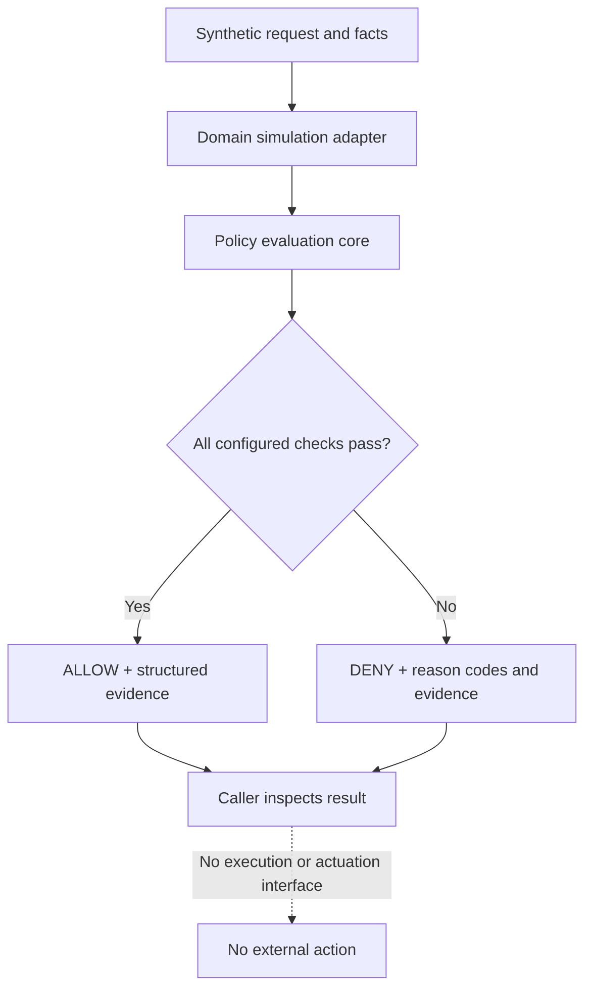

# Kernveil

**A local-first policy-evaluation and operational-resilience research prototype.**

Kernveil is an experimental, local-first reference platform for evaluating whether synthetic operational requests satisfy explicit policy, authorization, state, freshness, and evidence constraints. Its proposed next stage, **Kernveil Resilience Lab**, extends this foundation toward communication-trust validation and reproducible fault-injection testing.

The portfolio MVP combines a generic policy-evaluation core with domain-specific simulation adapters. Examples cover a railway-inspired scenario and generic IT operations, using synthetic inputs only.

> **Safety boundary:** This is a research and portfolio prototype, not a railway interlocking, train protection system, industrial safety controller, operational security gateway, or certified safety component. Never connect it to operational signalling, braking, dispatch, PLC/SCADA, production systems, or other safety-critical infrastructure. A demo decision is not a real-world safety guarantee. No technology can promise zero risk or eliminate every failure.

## Goals
- Explainable, deterministic allow-or-deny decisions.
- Fail closed when required data is missing, stale, inconsistent, or unauthorized.
- Keep generic policy logic separate from domain-specific constraints.
- Provide structured decision evidence.
- Test failure modes and invariants, not only happy paths.
- Remain local-first and easy to run.
- Evolve toward synthetic communication-integrity and resilience testing.

## Non-goals
- Replacing certified safety systems or human operational procedures.
- Calculating real braking curves, railway separation distances, route locking, or track occupancy.
- Claiming compliance, certification, zero risk, or complete attack prevention.
- Connecting to live telemetry or operational control paths.
- Executing commands or actuating external systems.

## Architecture


The generic core checks actor and command allow-lists, required facts, context freshness, and explicit equality conditions. The actor identifier is not authenticated identity, and input facts are not trusted sensor data. The core produces a decision and evidence only; it does not execute the requested command.

The generic core must not define railway distances, braking limits, occupancy interpretations, or industrial thresholds. Domain constraints belong in explicitly scoped simulation adapters.

## Quick start
Requirements: Git and Python 3.12.

```shell
git clone https://github.com/silvatechf/interlock-safety-operations.git
cd interlock-safety-operations
```

**Windows PowerShell:**
```powershell
py -3.12 -m venv .venv
.\.venv\Scripts\Activate.ps1
python -m pip install -e ".[dev]"
python examples/demo.py
pytest
ruff check .
mypy src
```

**macOS / Linux:**
```bash
python3.12 -m venv .venv
source .venv/bin/activate
python -m pip install -e ".[dev]"
python examples/demo.py
pytest
ruff check .
mypy src
```

## Demo output
Run the demo to see three synthetic policy evaluations:

| Scenario | Expected decision | Demonstration |
|---|---|---|
| Railway-inspired movement request; all example preconditions true | ALLOW | Configured actor, freshness, and required facts satisfy the example policy |
| Railway-inspired request; section reported occupied | DENY | A failed precondition prevents an allow decision |
| IT service restart; context is 31 seconds old | DENY | Stale context is rejected when the example policy allows at most 30 seconds |

The facts are caller-supplied synthetic assertions, not trusted sensor or identity-provider data. No command is executed and no external system is contacted. ALLOW illustrates policy evaluation only, not a real-world safety determination.

## Engineering practices demonstrated
- **Typed Python design:** validated models in [models.py](src/sentinel_interlock/models.py).
- **Defensive policy evaluation:** allow-lists, freshness checks, required facts, and explainable deny reasons in [engine.py](src/sentinel_interlock/engine.py).
- **Automated verification:** [Hypothesis property tests](tests/test_properties.py), [evidence serialization tests](tests/test_serialization.py), and [session/replay tests](tests/test_session.py).
- **Code-quality gates:** Ruff linting and strict mypy checking in [pyproject.toml](pyproject.toml).
- **Security hygiene:** Bandit, pip-audit, GitGuardian, and GitHub Actions pinned to full commit SHAs in [CI](.github/workflows/ci.yml).
- **Risk traceability:** [risk-to-test matrix](docs/risk-traceability.md) linking selected risks, mitigations, tests, architecture, and residual limitations.

These practices describe what is present in the repository; they do not mean all risks are eliminated or that the system is independently verified.

## Kernveil Resilience Lab — planned direction
The next prototype stage will explore synthetic communication validation and operational-resilience testing: message freshness, sequence and replay detection, integrity checks, contradictory states, clock uncertainty, service outages, and reproducible fault injection. The aim is to measure how the prototype handles explicitly defined failures—not to promise zero risk.

See the [Resilience Lab design](docs/resilience-lab.md) and [roadmap](docs/roadmap.md). These capabilities are planned, not implemented in the current MVP.

## Status
Portfolio-stage reference implementation. Current tests demonstrate only the software properties they cover, not operational safety or suitability.

## Docs
- [Architecture](docs/architecture.md)
- [Threat model](docs/threat-model.md)
- [Safety boundary and hazards](docs/safety-boundary.md)
- [Simulation scenarios](docs/simulations.md)
- [Risk-to-test traceability](docs/risk-traceability.md)
- [CI security maintenance](docs/ci-security-maintenance.md)
- [Portfolio scope review](docs/portfolio-scope-review.md)
- [Kernveil Resilience Lab design](docs/resilience-lab.md)
- [Roadmap](docs/roadmap.md)
- [Documentación en español](docs/es/README.md)

## License
MIT — see [LICENSE](LICENSE).
