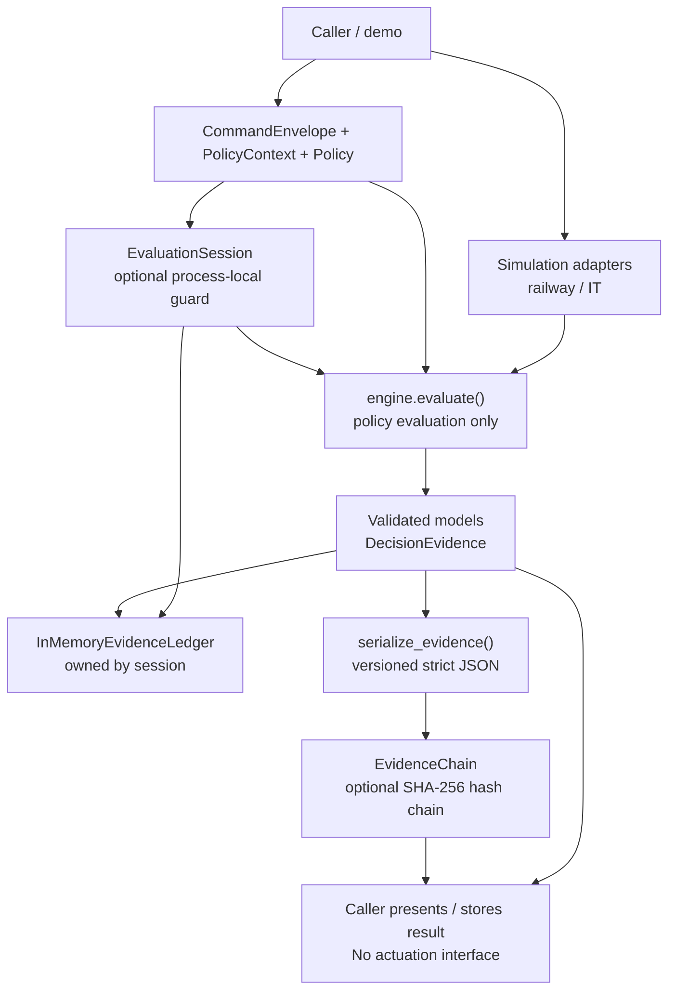

# Architecture

## Implemented architecture

The diagram below describes the current Python package and its actual call relationships. Optional components are shown separately: the session owns an in-memory ledger, while callers append decisions to an evidence chain explicitly.

### Components and responsibilities

- **Models — `models.py`:** `CommandEnvelope`, `PolicyContext`, `Policy`, conditions, decision status, and reason codes. Inputs reject undeclared fields and require timezone-aware timestamps. `DecisionEvidence` enforces a status/reason contract: `ALLOW` must have no denial reason codes; `DENY` must contain at least one.
- **Policy engine — `engine.py`:** `evaluate()` checks the actor allow-list assertion, command allow-list, required facts, context age, and equality preconditions. It returns `DecisionEvidence`; it never executes the requested command.
- **Simulation adapters — `adapters.py`:** railway-inspired and IT-maintenance examples construct synthetic commands, facts, and policies, then call the generic engine. They do not connect to real systems.
- **Evaluation session — `session.py`:** optional wrapper that serializes calls under a process-local lock, rejects previously seen command IDs, and appends each decision to its `InMemoryEvidenceLedger`.
- **Evidence ledger — `ledger.py`:** stores decision objects in memory and exposes tuple snapshots. It is neither durable nor tamper-evident.
- **Serialization — `serialization.py`:** versioned JSON conversion with deterministic key ordering, a 1 MiB payload limit, duplicate-key rejection, and rejection of non-standard/non-finite numbers and schema-invalid decisions.
- **Evidence chain — `evidence_chain.py`:** caller-managed, in-memory chain over serialized decisions. Each record commits to its sequence, previous hash, and payload with SHA-256 over canonical JSON. The chain is not automatically attached to the session or ledger; the caller explicitly appends decisions.

## Data and trust boundaries

The caller supplies commands, context facts, policy configuration, and timestamps. The engine treats these as assertions, not independently verified truth. An `actor_id` is not proof of identity, and adapter facts are not proof of sensor provenance. The package does not authenticate callers, validate facts against trusted sensors, authorize policy authors, or govern policy changes.

The evidence output explains what the evaluator checked using the supplied inputs. It does not prove that those inputs were true or that an external action occurred.

## Duplicate handling and concurrency

The optional session guard tracks command IDs in process memory and uses a lock to serialize calls within that session. State is lost on restart and is not shared across processes or hosts. It is not durable idempotency or distributed replay protection. The standalone `evaluate()` function does not provide duplicate-command tracking.

## Serialization and evidence integrity

Strict evidence serialization protects parsing and representation boundaries; serialization alone is not cryptographic integrity. The separate `EvidenceChain` detects payload edits, middle-record removal, reordering, and broken links when the verifier has the expected chain.

The hash chain is not an authenticated signature or proof of who created a record. An attacker able to rewrite the entire chain can recompute every hash. Removing a suffix, including the final record, cannot be detected without an independently retained checkpoint, trusted signature, or external anchor. The chain is in memory only and is not durable. It is not automatically persisted by the ledger.

## Domain separation and safety scope

The core remains domain-neutral. The railway-inspired and IT adapters are synthetic demonstrations only. There is no live telemetry, PLC/SCADA integration, signalling or dispatch connection, braking logic, train control, service restart, or other external actuation.

This repository is a software reference and portfolio project, not an operational railway interlocking, safety controller, certified component, safety case, or production-ready control system. CI and tests provide software-quality evidence only; they do not establish operational safety or regulatory compliance.

## Known gaps

Durable replay defense and idempotency, cryptographically bound identity, trusted sensor provenance, signed or externally anchored evidence, durable storage, distributed consistency, trusted time, policy governance and rollback, independent verification, broader fuzzing/fault injection, and domain-specific hazard analysis remain unimplemented.
