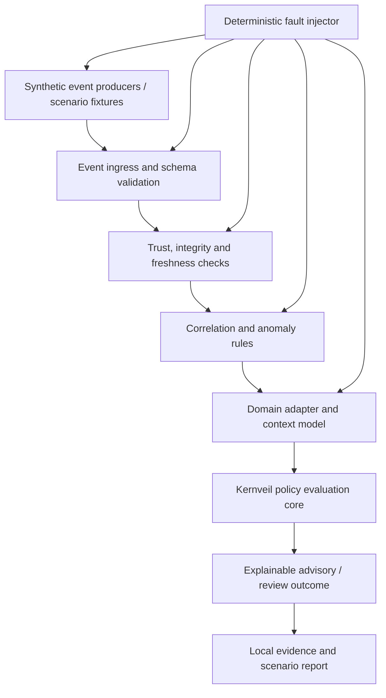

# Kernveil Resilience Lab — prototype direction

## Purpose

Kernveil Resilience Lab is a local-first research and portfolio prototype for evaluating the trustworthiness of synthetic operational events and testing resilience under explicitly modelled failures.

The product is **domain-agnostic at its core**. Transportation is the first application family, with road incidents and infrastructure disruption as the first demonstrator. Railway, aviation, and maritime scenarios can follow as separate adapters. The same validation primitives may later apply to other critical or high-availability environments, but each domain requires its own threat model, semantics, risk analysis, and qualified review.

The central question is: given an event, its declared source, timing, integrity metadata, and surrounding synthetic context, can Kernveil identify what is valid, stale, duplicated, contradictory, or uncertain, explain the result, and avoid presenting uncertainty as fact?

This is a design proposal. Capabilities below are planned unless explicitly implemented elsewhere in the repository.

## Product boundary

Kernveil is an independent event-validation and resilience-testing layer in a simulation environment. It is not a navigation service, traffic-management platform, dispatch system, certified safety component, or replacement for domain operators and procedures.

The prototype will ingest synthetic events and simulated states; validate structure, source claims, integrity metadata, sequence, freshness, and consistency; evaluate explicit policies; inject selected faults; and produce repeatable evidence and reports.

It will not connect to live road infrastructure, traffic-light controllers, vehicles, aircraft, vessels, railway networks, telemetry, signalling, dispatch, PLC/SCADA, braking, or production systems. It will not send commands, actuate equipment, direct vehicles, or make operational decisions. It will not claim zero risk, complete attack prevention, certification, or regulatory conformity.

## Domain strategy

The common core provides reusable technical primitives. Domain adapters define event meaning, context, constraints, and scenario-specific expected outcomes.

| Domain | Example synthetic event | First demonstrable question |
|---|---|---|
| Road transport | Traffic light outage, collision report, road closure, hazard report | Are reports fresh, non-duplicated, sufficiently corroborated, and consistent before an advisory is shown? |
| Rail | Track occupancy assertion, service disruption, communications loss | Are synthetic state messages fresh, ordered, and mutually consistent? |
| Aviation | Weather update, NOTAM-like advisory fixture, simulated subsystem alert | Is the information current, correctly scoped, and internally consistent? |
| Maritime | Navigation hazard report, position update, communications outage | Are event age, source claims, sequence, and conflicting reports handled explicitly? |

These are simulation examples, not validated operational rules. In particular, Kernveil must not infer that a traffic light is safe to cross, calculate aircraft separation, direct a vessel, or authorize train movement.

## Proposed logical architecture

This is conceptual, not a deployed operational architecture. The current policy engine and evidence contracts are the starting foundation. Event ingress, trust validation, correlation, fault injection, and the inspection interface are future work.

## Proposed components

### Synthetic event envelope

Define a versioned envelope with event ID, source identifier, event type, schema version, sequence number, event and observation timestamps, expiry or validity window, payload digest, correlation ID, and simulation scenario ID.

A claimed source identifier is not authenticated identity. A digest detects content changes only when the expected digest is trusted; it does not authenticate the sender. Signature verification, if introduced, must use test-only keys and an explicit key lifecycle.

### Trust and freshness validator

Evaluate schema validity, source allow-list, event age and expiry, sequence continuity, duplicate IDs, payload digest consistency, and clock uncertainty assumptions. Missing, contradictory, expired, or unverifiable required evidence must not be silently treated as valid.

Time checks must model clock uncertainty rather than assuming timestamps are inherently trustworthy. The validator should distinguish invalid, stale, unknown, and indeterminate results instead of collapsing them into a misleading boolean.

### Correlation and anomaly rules

Start with deterministic, explainable checks:
- duplicate or replayed events;
- out-of-order sequence numbers and unexpected gaps;
- delayed or expired events;
- conflicting state claims from synthetic sources;
- malformed or oversized payloads;
- source or signature validation failures;
- channel loss, recovery, and retry bursts;
- multiple reports that refer to the same simulated incident.

Do not equate multiple reports with independent corroboration: their provenance and correlation may be shared. Statistical or ML anomaly detection may be explored later as an advisory signal, never as the sole decision gate.

### Domain adapters

Adapters translate domain-specific event types into explicit context and policy inputs. The first adapter should be road-disruption simulation: traffic-light outage, collision, road closure, debris/hazard report, stale report, duplicate crowd-sourced report, and contradictory reports.

A road adapter may classify information for an advisory demonstration, but it must not tell a driver to proceed through an intersection or override road signs, traffic lights, emergency services, or official instructions. Railway, aviation, and maritime adapters remain separate follow-on work with synthetic fixtures only.

### Policy evaluation

Reuse the existing deterministic policy engine where appropriate. Extend input contracts only after defining invariants and tests. The engine remains non-actuating and domain-neutral; domain-specific assumptions belong in simulation adapters.

### Fault-injection controller

Allow a demo operator to inject controlled faults into synthetic events: latency and jitter, event loss, duplication and replay, reordering, payload corruption, source outage, contradictory state, clock skew, partial service failure, and recovery bursts.

Each scenario defines initial conditions, injected fault, expected detection, expected advisory/review outcome, evidence assertions, and known blind spots.

### Evidence and reporting

Produce a local report containing scenario configuration, injected events, observed events, validation results, policy outcome, reason codes, timing measurements, and evidence-chain verification result.

The current SHA-256 chain is in-memory and unauthenticated. A future durable evidence design must consider signed checkpoints or independently retained anchors, key custody, crash consistency, and truncation detection. A hash chain alone is not proof of authenticity or tamper-proof storage.

## Initial road-resilience demonstration scenarios

| Scenario | Injected condition | Expected prototype behavior |
|---|---|---|
| Healthy event | Valid, fresh, well-formed road-hazard report | Validate and classify for advisory review |
| Traffic-light outage | Synthetic infrastructure outage event | Surface outage and uncertainty; never infer right-of-way |
| Stale report | Report exceeds configured validity window | Mark stale; do not present as current |
| Duplicate crowd report | Same event submitted repeatedly | Deduplicate or correlate; do not inflate corroboration |
| Contradictory reports | Sources report incompatible road states | Mark context inconsistent and request review |
| Unknown source | Source absent from simulation trust configuration | Mark untrusted or unknown; do not infer identity |
| Corrupted payload | Payload differs from trusted fixture digest | Reject integrity check |
| Clock skew | Source time outside configured uncertainty bounds | Mark freshness indeterminate |
| Connectivity outage | Event stream stops arriving | Report loss of observability within declared assumptions |
| Recovery burst | Reconnection produces duplicate and delayed reports | Preserve replay/order checks and report backlog behavior |

A passing scenario means only that the implementation behaved as specified for that scenario. It does not establish coverage of all failures or attacks.

## Measurement and acceptance criteria

Report measurable results rather than claiming zero risk:
- detection rate for explicitly enumerated injected cases;
- false-positive and false-negative counts for the defined test corpus;
- duplicate suppression and correlation accuracy for labelled fixtures;
- event validation and decision latency under documented local test conditions;
- behavior during outage, recovery, and burst traffic;
- reproducibility from a fixed scenario seed and configuration;
- evidence verification success and known truncation/rewrite limitations;
- test coverage of fail-closed behavior and unexpected exceptions.

Every metric must state its test corpus, environment, assumptions, and limitations. A 100% detection result on a finite synthetic suite must never be generalized into 100% real-world protection.

## Delivery plan

### Phase 1 — Contracts and threat model
- [ ] Define a versioned event envelope and trust assumptions.
- [ ] Define source claims, integrity, freshness, sequence, correlation, and clock uncertainty.
- [ ] Map threats to explicit invariants and test cases.
- [ ] Document behavior for indeterminate and contradictory inputs.

### Phase 2 — Deterministic event validator
- [ ] Implement structural, digest, sequence, replay, freshness, and correlation checks.
- [ ] Return stable reason codes and structured evidence.
- [ ] Add property-based tests for malformed, duplicated, reordered, stale, and contradictory events.

### Phase 3 — Road-disruption simulator
- [ ] Add deterministic synthetic event producers and fixtures.
- [ ] Model traffic-light outage, collision, road closure, hazard reports, duplicate reports, and contradictory information.
- [ ] Add latency, loss, duplication, reordering, corruption, outage, and clock-skew injectors.
- [ ] Make scenarios reproducible and safe to run offline.
- [ ] Add regression fixtures for each documented failure.

### Phase 4 — Domain adapters
- [ ] Reuse the core contracts for a railway-inspired adapter.
- [ ] Evaluate separate maritime and aviation adapters only after domain-specific threat models and scope reviews.
- [ ] Keep every adapter synthetic and non-actuating.

### Phase 5 — Evidence and inspection
- [ ] Produce scenario reports and local inspection views.
- [ ] Measure detection latency and false-positive/negative counts.
- [ ] Evaluate durable evidence, signed checkpoints, and key lifecycle separately.

### Phase 6 — Independent review
- [ ] Conduct an independent architecture and threat-model review.
- [ ] Seek qualified domain review before making domain-specific assurance claims.
- [ ] Keep operational integration out of this portfolio prototype.

## Safety and assurance statement

Kernveil Resilience Lab is a local, synthetic-data research and portfolio prototype. It is not a safety instrumented system, certified transportation product, safety case, navigation service, or production security gateway. It cannot eliminate all communication or technology failures. Its purpose is to make selected failure modes observable, testable, explainable, and reproducible, and to demonstrate bounded handling of uncertainty within explicitly defined simulations.
