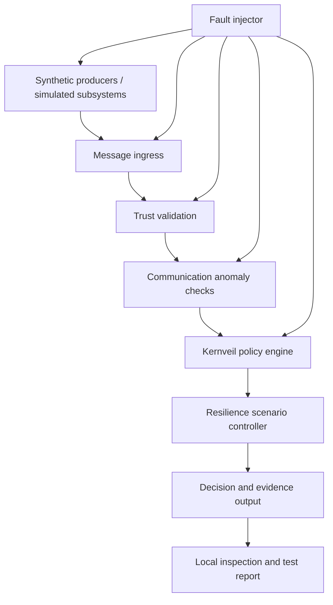

# Kernveil Resilience Lab — prototype direction

## Purpose

Kernveil Resilience Lab is the proposed next-stage portfolio prototype for evaluating communication trust and operational resilience in safety-sensitive environments. Railway operations are the first synthetic demonstration domain, not the product's only possible domain.

The lab explores this question: given a synthetic operational message and the evidence available to the evaluator, can the platform detect that the message or its context is not trustworthy, explain why, and fail safely without executing an operation?

This is a design proposal. The capabilities below are planned unless explicitly implemented elsewhere in this repository.

## Product boundary

Kernveil is an independent verification and resilience-testing layer in a simulation environment. It is not a replacement for railway signalling, interlocking, train protection, traffic management, communications infrastructure, or operator procedures.

The prototype will ingest synthetic messages and simulated states; validate structure, origin claims, integrity metadata, sequence, freshness, and consistency; evaluate explicit policies; detect selected communication and component failure modes; and produce repeatable evidence and reports.

It will not connect to live railway networks, telemetry, signalling, dispatch, PLC/SCADA, braking, or production systems. It will not send commands, actuate equipment, or make operational decisions. It will not claim zero risk, complete attack prevention, certification, or regulatory conformity.

## Proposed logical architecture

This is conceptual, not a deployed railway or certified safety architecture. The current policy engine and evidence contracts are the starting foundation. Message ingress, trust validation, anomaly checks, fault injection, and the inspection interface are future work.

## Proposed components

### Synthetic message envelope

Define a versioned envelope with message ID, source identifier, message type, schema version, sequence number, creation and expiry timestamps, payload digest, correlation ID, and simulation scenario ID. Signature metadata may be added in a later phase.

A claimed source identifier is not authenticated identity. A digest detects content changes only when the expected digest is trusted; it does not authenticate the sender.

### Trust and freshness validator

Evaluate schema validity, source allow-list, message age and expiry, sequence continuity, duplicate IDs, payload digest consistency, and clock uncertainty assumptions. Optional signature verification can follow using test-only keys and an explicit key lifecycle.

Missing, contradictory, expired, or unverifiable required evidence must not be silently treated as valid. Time checks must model clock uncertainty rather than assuming timestamps are inherently trustworthy.

### Communication anomaly detector

Start with deterministic, explainable checks:
- duplicate or replayed messages;
- out-of-order sequence numbers and unexpected gaps;
- delayed messages;
- conflicting state claims from simulated sources;
- malformed or oversized payloads;
- source or signature validation failures;
- channel loss, recovery, and retry bursts.

Statistical anomaly detection may be explored later as an advisory signal, never as the sole safety gate.

### Policy evaluation

Reuse the existing deterministic policy engine where appropriate. Extend input contracts only after defining invariants and tests. The engine remains non-actuating and domain-neutral; railway-specific assumptions belong in synthetic scenario adapters.

### Fault-injection controller

Allow a demo operator to inject controlled faults into synthetic traffic: latency and jitter, message loss, duplication and replay, reordering, payload corruption, source outage, contradictory state, clock skew, partial service failure, and recovery storms.

Each scenario defines initial conditions, injected fault, expected detection, expected fail-safe outcome, evidence assertions, and known blind spots.

### Evidence and reporting

Produce a local report containing scenario configuration, injected events, observed events, detection results, policy outcome, reason codes, timing measurements, and evidence-chain verification result.

The current SHA-256 chain is in-memory and unauthenticated. A future durable evidence design must consider signed checkpoints or independently retained anchors, key custody, crash consistency, and truncation detection. A hash chain alone is not proof of authenticity or tamper-proof storage.

## Demonstration scenarios

| Scenario | Injected condition | Expected prototype behavior |
|---|---|---|
| Healthy synthetic exchange | Valid, fresh, ordered message | Continue to policy evaluation and report checks |
| Replay | Previously accepted message ID or sequence repeated | Detect replay and reject the message |
| Out of order | Sequence arrives behind last accepted sequence | Flag ordering violation and reject or quarantine by explicit policy |
| Stale message | Message exceeds configured freshness window | Reject as stale; never infer current state |
| Corrupted payload | Payload no longer matches trusted digest | Reject integrity check |
| Unknown source | Source absent from simulation trust configuration | Reject or quarantine; do not infer identity |
| Conflicting state | Synthetic sources report incompatible states | Mark context inconsistent and fail closed pending resolution |
| Clock skew | Source time is outside configured uncertainty bounds | Mark freshness indeterminate; do not treat as fresh |
| Channel outage | Messages stop arriving | Detect timeout only within declared simulation assumptions |
| Recovery storm | Reconnection causes duplicates and bursts | Preserve ordering/replay controls and report overload behavior |

A passing scenario means only that the implementation behaved as specified for that scenario. It does not establish coverage of all failures or attacks.

## Measurement and acceptance criteria

Report measurable results rather than claiming zero risk:
- detection rate for explicitly enumerated injected cases;
- false-positive and false-negative counts for the defined test corpus;
- decision and detection latency under documented local test conditions;
- behavior during outage, recovery, and burst traffic;
- reproducibility from a fixed scenario seed and configuration;
- evidence verification success and known truncation/rewrite limitations;
- test coverage of fail-closed behavior and unexpected exceptions.

Every metric must state its test corpus, environment, assumptions, and limitations. A 100% detection result on a finite synthetic suite must never be generalized into 100% real-world protection.

## Delivery plan

### Phase 1 — Contracts and threat model
- [ ] Define message envelope and versioning.
- [ ] Define source identity, trust, freshness, sequence, and clock assumptions.
- [ ] Map threats to explicit invariants and test cases.
- [ ] Document fail-safe behavior for indeterminate and contradictory inputs.

### Phase 2 — Deterministic communication validator
- [ ] Implement structural, digest, sequence, replay, and freshness checks.
- [ ] Return stable reason codes and structured evidence.
- [ ] Add property-based tests for malformed, duplicated, reordered, stale, and contradictory messages.

### Phase 3 — Fault-injection simulator
- [ ] Add deterministic synthetic message producers.
- [ ] Add latency, loss, duplication, reordering, corruption, outage, and clock-skew injectors.
- [ ] Make scenarios reproducible and safe to run offline.
- [ ] Add regression fixtures for each documented failure.

### Phase 4 — Evidence and inspection
- [ ] Produce scenario reports and local inspection views.
- [ ] Measure detection latency and false-positive/negative counts.
- [ ] Evaluate durable evidence, signed checkpoints, and key lifecycle separately.

### Phase 5 — Independent review
- [ ] Conduct an independent architecture and threat-model review.
- [ ] Review assumptions with qualified railway safety and cybersecurity specialists before domain-specific assurance claims.
- [ ] Keep operational integration out of this portfolio prototype.

## Safety and assurance statement

Kernveil Resilience Lab is a local, synthetic-data research and portfolio prototype. It is not a safety instrumented system, certified railway product, safety case, or production security gateway. It cannot eliminate all communication or technology failures. Its purpose is to make selected failure modes observable, testable, explainable, and reproducible, and to demonstrate fail-safe handling within explicitly bounded simulations.
